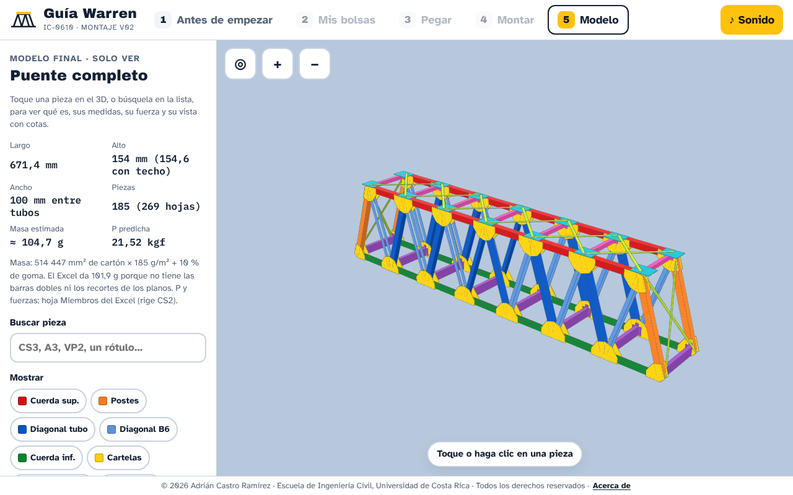
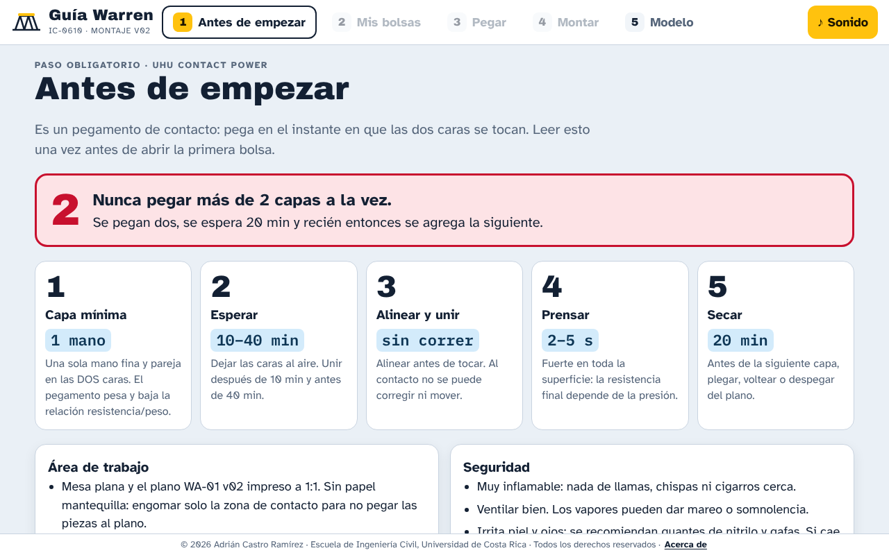
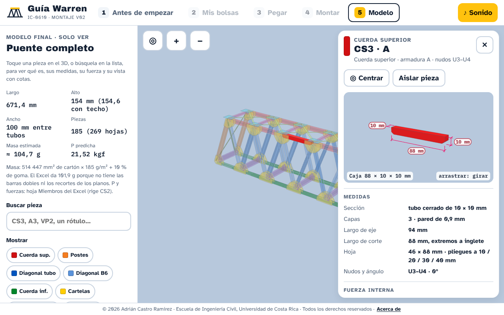
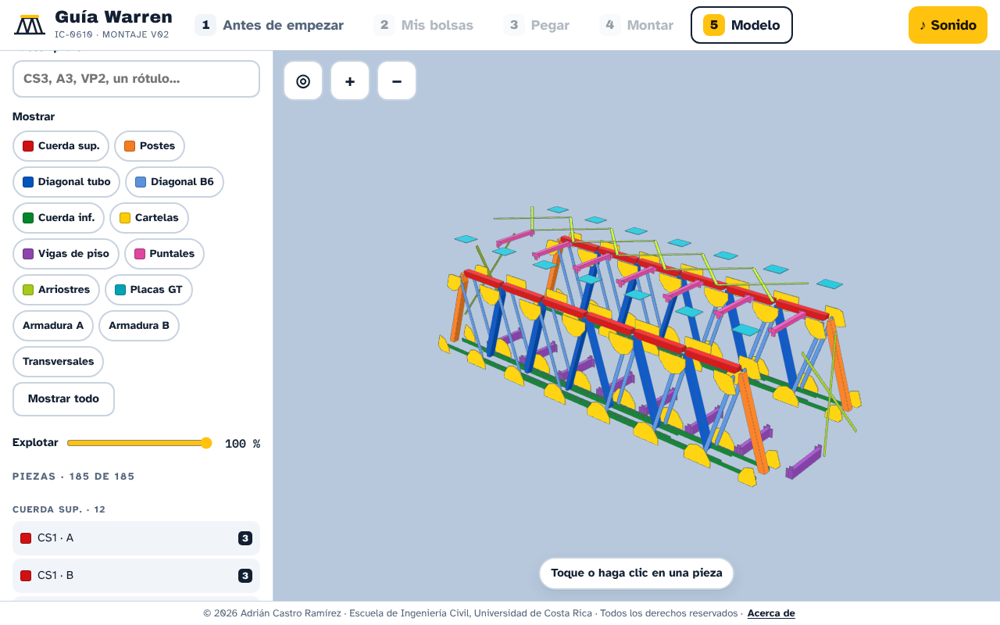

# Puente Warren de cartón · IC-0610 Mecánica de Sólidos II

**Legado académico y trabajo de referencia** · Escuela de Ingeniería Civil · Universidad de Costa Rica · II ciclo 2026

> **Guía interactiva de montaje 3D → [adrianix360.github.io/Proyecto_mecanica_del_solido_2](https://adrianix360.github.io/Proyecto_mecanica_del_solido_2/)**
> Funciona en el navegador, en computadora, tableta y teléfono (requiere conexión a internet).



---

## 1. Qué es este repositorio

Este repositorio documenta, de principio a fin, el diseño, el análisis y la preparación de construcción de un **puente de armadura tipo Warren sin verticales**, hecho con cartón de carpetas de manila y adhesivo de contacto, para el proyecto del curso **IC-0610 Mecánica de Sólidos II**. Se publica como **registro de consulta y trabajo de referencia** para quienes, en el futuro, quieran entender cómo se resolvió un proyecto de este tipo: de dónde salen los datos, cómo se calculan las fuerzas internas, cómo se predice la carga de colapso y cómo se pasa de un modelo de cálculo a planos, piezas cortadas y un montaje guiado.

Es una iniciativa propia de su autor. **No es una plantilla ni un material para copiar**: léalo para aprender el método, no para reproducirlo (ver la sección [Aviso de uso](#9-aviso-de-uso-y-prohibición-de-replicación)).

## 2. Estado del proyecto

| Componente | Estado |
|---|---|
| Informe de avance (escrito) | Disponible · carpeta [`01_avance_escrito`](01_avance_escrito) |
| Análisis estructural (nodos y CSiBridge) | Disponible · carpeta [`02_analisis_estructural`](02_analisis_estructural) |
| Planos de montaje v02 | Disponible · carpeta [`03_planos_de_montaje`](03_planos_de_montaje) |
| Despiece y corte (Cameo) v02 | Disponible · carpeta [`04_despiece_corte_cameo`](04_despiece_corte_cameo) |
| Guía interactiva de montaje 3D v02 | Disponible · [enlace](https://adrianix360.github.io/Proyecto_mecanica_del_solido_2/) |
| Revisión técnica independiente del diseño | Disponible · carpeta [`06_revision_de_diseno`](06_revision_de_diseno) |
| Video y registro de la falla del puente | **Pendiente** · [`08_falla_del_puente`](08_falla_del_puente) |
| Informe final | **Pendiente** · [`09_informe_final`](09_informe_final) |

La prueba de carga estaba programada para el 6 de noviembre de 2026 y el informe final para el 10 de noviembre de 2026. Este repositorio se actualizará con el video de la falla, la comparación entre la carga predicha y la medida, y el informe final.

## 3. Resumen técnico

| Aspecto | Valor |
|---|---|
| Tipología | Armadura Warren sin verticales; dos armaduras paralelas con vigas de piso, puntales y arriostramiento superior |
| Material | Cartón de carpetas de manila; adhesivo de contacto |
| Armadura | 658 mm entre ejes de apoyos; 144 mm de altura entre ejes de cuerdas; 7 paneles de 94 mm |
| Separación | 90 mm entre planos medios de las armaduras (100 mm exteriores) |
| Miembros | 27 por armadura (15 nudos; isostática): 7 de cuerda inferior, 6 de cuerda superior, 12 diagonales y 2 postes extremos |
| Vigas de piso / puntales | VP0 a VP7 de 15 × 6 mm; siete puntales de 6 × 6 mm |
| Cargas de ensayo | Cuatro cargas P/4 sobre los nudos centrales de la cuerda inferior |
| Análisis | Método de nodos a mano, contrastado con CSiBridge; coeficientes de fuerza interna `k` por miembro |
| Datos de resistencia | Probetas históricas de semestres anteriores (tensión por ancho y compresión por longitud) |
| Carga de primera falla calculada | 21,58 kgf (rige la cuerda superior en compresión) |
| **Carga de colapso predicha** | **≈ 12,3 kgf**, al aplicar un factor de seguridad FS = 1,75 |
| Corte | 13 tapetes de 235 × 300 mm (T00 de prueba, T01–T11 y T12 retenido por la observación H-01); 269 hojas de piezas |
| Masa estimada | ≈ 104,7 g (514 447 mm² de cartón a 185 g/m² más 10 % de adhesivo) |

> Nota sobre cifras: el informe de avance reporta 12,3 kgf (con FS = 1,75). La pestaña «Modelo» de la guía 3D muestra las fuerzas con la carga de primera falla de la hoja `Miembros` del Excel (≈ 21,5 kgf, sin factor de seguridad). Son dos lecturas del mismo cálculo, no una contradicción.

## 4. Contenido del repositorio

```text
Proyecto_mecanica_del_solido_2/
├── README.md
├── LICENSE
├── docs/                              Página web (GitHub Pages): guía interactiva de montaje 3D
├── 00_enunciado_y_referencias/        Contexto: enunciado, bibliografía base, plano base y datos históricos
├── 01_avance_escrito/                 Informe de avance (PDF, copia pública sin autoría)
├── 02_analisis_estructural/           Especificación (Excel), nodos a mano y modelo de CSiBridge
├── 03_planos_de_montaje/              Láminas WA-01 a WA-05 (PDF A0 a 1:1 y DXF), versión v02
├── 04_despiece_corte_cameo/           Tapetes DXF, control, guía de Silhouette, inventario y QA, v02
├── 05_guia_montaje_3d/                Informe de QA de la guía y capturas de pantalla
├── 06_revision_de_diseno/             Revisión técnica independiente (informe y verificación)
├── 07_graficos_y_prediccion/          Gráficos de resistencia y predicción con probetas 2018–2019
├── 08_falla_del_puente/               (pendiente) video y registro del ensayo
└── 09_informe_final/                  (pendiente) informe final
```

### Cómo leerlo en orden

1. **`00`**: qué pedía el proyecto y con qué información se contaba.
2. **`01`**: el razonamiento del diseño, las fuerzas internas y la predicción.
3. **`02`**: la geometría de referencia (`Especificacion_Puente_Warren.xlsx`) y los dos análisis estructurales.
4. **`03` y `04`**: cómo se llevó el diseño a planos y a piezas cortables.
5. **`05` y la [guía web](https://adrianix360.github.io/Proyecto_mecanica_del_solido_2/)**: cómo se arma, paso a paso.
6. **`06`**: la auditoría independiente que corrigió observaciones del diseño antes de cortar.

## 5. La guía interactiva de montaje 3D

Es una aplicación web de un solo archivo (`docs/index.html`, con Three.js) que guía el armado por el método de Ressler:

- **Antes de empezar**: pantalla obligatoria con las reglas del adhesivo de contacto (tiempos de espera y máximo de dos capas a la vez).
- **Mis bolsas**: selección de las bolsas de piezas con su inventario.
- **Pegar**: 56 pasos en 12 bolsas, con temporizadores de 10 y 20 minutos.
- **Montar**: 41 pasos en 3D, con el volteo de las mitades animado.
- **Modelo**: el puente completo; al tocar una pieza se abre su ficha con medidas, vista con cotas, fuerza interna, capacidad, área, masa y pasos de pegado y montaje.

Su verificación automática (15 de 15 comprobaciones de consistencia más pruebas de navegador) está en [`05_guia_montaje_3d/QA_guia_v02.md`](05_guia_montaje_3d/QA_guia_v02.md). El avance de cada persona se guarda solo en su propio navegador.

| Pegar y montar | Ficha de una pieza | Vista explotada |
|---|---|---|
|  |  |  |

## 6. Método resumido

1. **Datos de resistencia**: se consolidan resultados históricos de probetas de tensión (barras de 4, 6 y 8 mm) y de compresión (tubos de 10 × 10 y 6 × 10 mm a varias longitudes), se promedian y se documenta su dispersión.
2. **Geometría**: armadura Warren sin verticales dentro de los límites del enunciado (700 ± 50 mm de largo, 100 ± 10 mm de ancho, 150 ± 10 mm de alto).
3. **Fuerzas internas**: método de nodos a mano y modelo en CSiBridge, con una carga de referencia P = 1 kgf (cuatro cargas P/4), y comparación entre ambos.
4. **Predicción**: para cada miembro, P<sub>i</sub> = R<sub>i</sub> / |k<sub>i</sub>|; rige el menor, y se aplica un factor de seguridad.
5. **Planos y despiece**: láminas a escala 1:1, miembros identificados y piezas distribuidas en tapetes de corte.
6. **Revisión independiente**: auditoría de geometría, fuerzas, planos y capacidades antes de cortar.
7. **Montaje guiado**: la guía 3D.
8. **Ensayo y comparación**: pendiente.

## 7. Cómo citar

Si este trabajo le sirvió como referencia para estudiar, cítelo así (formato IEEE):

> A. Castro Ramírez, «Puente Warren de cartón: diseño, análisis y montaje guiado (IC-0610 Mecánica de Sólidos II)», repositorio de GitHub, Escuela de Ingeniería Civil, Universidad de Costa Rica, 2026. [En línea]. Disponible: https://github.com/adrianix360/Proyecto_mecanica_del_solido_2

## 8. Integridad académica

Este material es una **referencia para aprender el método**. Presentarlo, total o parcialmente, como trabajo propio en un curso, copiar sus cálculos, planos, texto o cifras, o adaptar su diseño para una entrega es una falta a la integridad académica, independientemente de lo que permita la tecnología del repositorio. Las fuentes que se usen deben citarse y el trabajo entregado debe ser original.

## 9. Aviso de uso y prohibición de replicación

**© 2026 Adrián Castro Ramírez. Todos los derechos reservados.**

Este repositorio es público únicamente para **consulta y lectura**. **No se autoriza**, sin permiso previo y por escrito del autor:

- copiar, reproducir, redistribuir, publicar de nuevo o alojar en otro sitio, total o parcialmente, los planos, el despiece, los archivos de CSiBridge, la guía web, el código de la página, los textos, las tablas, los gráficos y las cifras;
- **replicar el diseño o su construcción**, o fabricar piezas a partir de los DXF y planos, para una entrega, una evaluación o cualquier otro fin;
- modificar o crear obras derivadas, o presentar el trabajo, o partes de él, como propio;
- usar el contenido con fines comerciales o para entrenar sistemas automáticos.

Al ser un repositorio público, GitHub permite técnicamente verlo y bifurcarlo (*fork*), pero **eso no concede ninguna licencia de uso**. El texto completo está en [`LICENSE`](LICENSE).

**Material de terceros.** La carpeta [`00_enunciado_y_referencias`](00_enunciado_y_referencias) contiene documentos que **no son del autor** (enunciado y presentaciones de la docente, publicaciones de Ressler, un plano base de un semestre anterior y datos de ensayos de probetas de semestres anteriores). Se incluyen únicamente como contexto académico, conservan los derechos de sus respectivos titulares y **no están cubiertos por esta licencia**. Si es titular de alguno de ellos y desea que se retire, escriba al autor y se eliminará.

## 10. Autoría, créditos y uso de IA

- **Autor del repositorio, de los planos de montaje, del despiece de corte, de la guía 3D y del análisis estructural en CSiBridge:** Adrián Castro Ramírez, Escuela de Ingeniería Civil, Universidad de Costa Rica.
- **Informe de avance:** elaborado en grupo por el equipo de trabajo del curso. Su portada se publica sin nombres ni carnés.
- **Base de diseño:** el plano Warren de un semestre anterior (`00_enunciado_y_referencias/plano_base_semestre_anterior`) sirvió de punto de partida; la geometría se validó y adaptó para este proyecto.
- **Metodología:** S. J. Ressler, *Designing and Building File-Folder Bridges*, y los lineamientos del enunciado de la profesora del curso.
- **Uso de IA:** los planos, el despiece, la guía 3D y la revisión técnica se elaboraron con ayuda de Claude (Anthropic). Las decisiones de diseño, las verificaciones y la responsabilidad del contenido son del autor.

## 11. Contacto

Para solicitar permisos, reportar un error o pedir el retiro de material de terceros, escriba por el perfil de GitHub del autor: [@adrianix360](https://github.com/adrianix360).
